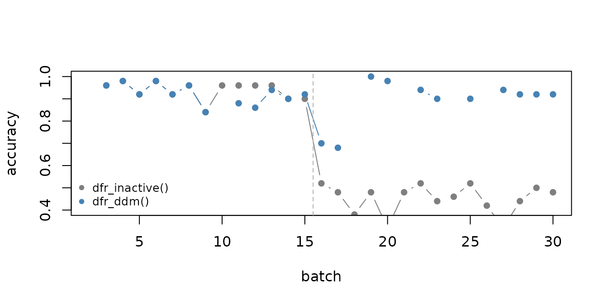

# Adapting models to concept drift

Detecting a drift is only useful if the model reacts to it.
[`stealthy()`](https://cefet-rj-dal.github.io/heimdall/reference/stealthy.md)
wraps a classifier and a drift detector: at every call to
[`fit()`](https://rdrr.io/pkg/daltoolbox/man/fit.html) it checks the new
batch for drift and, when one is found, discards the old training data
and retrains the model on the new concept.

``` r

library(daltoolbox)
library(heimdall)
```

## A stream with real concept drift

The stream below has two numeric features drawn from the same
distribution during the whole stream. Only the rule that defines the
target changes: up to observation 750 the target is `x1 + x2 > 0`, and
from then on it is `x1 - x2 > 0`. This is real concept drift, because
the inputs look the same but their relationship with the target has
changed.

``` r

set.seed(1)
n <- 1500
x <- data.frame(x1 = rnorm(n), x2 = rnorm(n))
new_concept <- seq_len(n) > 750
target <- ifelse(new_concept, x$x1 - x$x2 > 0, x$x1 + x$x2 > 0)
y <- data.frame(target = factor(target, levels = c(FALSE, TRUE)))

batch <- (seq_len(n) - 1) %/% 50 + 1
```

## Training and testing batch by batch

The stream is processed in batches of 50 observations. Each batch is
first used to test the current model and is then given to
[`fit()`](https://rdrr.io/pkg/daltoolbox/man/fit.html), which updates
the model with it. The classifier is a naive Bayes model from
`daltoolbox`.

``` r

run_stream <- function(detector) {
  model <- stealthy(cla_nb("target", c("FALSE", "TRUE")), detector, warmup_size = 100)
  results <- NULL
  for (b in 2:max(batch)) {
    train <- batch == (b - 1)
    test <- batch == b
    model <- fit(model, x[train, ], y[train, , drop = FALSE])

    accuracy <- NA
    if (model$fitted) {
      prediction <- predict(model, x[test, ])
      accuracy <- mean((prediction[, 2] > 0.5) == (y$target[test] == "TRUE"))
    }
    results <- rbind(results, data.frame(batch = b, drifted = model$drifted, accuracy = accuracy))
  }
  results
}
```

[`dfr_inactive()`](https://cefet-rj-dal.github.io/heimdall/reference/dfr_inactive.md)
never reports a drift, so that model keeps accumulating data from both
concepts.
[`dfr_ddm()`](https://cefet-rj-dal.github.io/heimdall/reference/dfr_ddm.md)
monitors the mistakes of the classifier.

``` r

without_detector <- run_stream(dfr_inactive())
with_ddm <- run_stream(dfr_ddm())

with_ddm[with_ddm$drifted, ]
#>    batch drifted accuracy
#> 9     10    TRUE       NA
#> 17    18    TRUE       NA
#> 20    21    TRUE       NA
#> 23    24    TRUE       NA
#> 25    26    TRUE       NA
```

After the drift is detected, the model needs `warmup_size` observations
before it is trained again, which is why the accuracy is missing for one
batch.

``` r

plot(without_detector$batch, without_detector$accuracy,
  type = "b", pch = 16,
  ylim = c(0.4, 1), col = "grey50", xlab = "batch", ylab = "accuracy"
)
lines(with_ddm$batch, with_ddm$accuracy, type = "b", pch = 16, col = "steelblue")
abline(v = 750 / 50 + 0.5, lty = 2, col = "grey70")
legend("bottomleft", c("dfr_inactive()", "dfr_ddm()"),
  col = c("grey50", "steelblue"),
  pch = 16, bty = "n", cex = 0.8
)
```



``` r

after <- with_ddm$batch > 16
c(
  without_detector = mean(without_detector$accuracy[after], na.rm = TRUE),
  with_ddm = mean(with_ddm$accuracy[after], na.rm = TRUE)
)
#> without_detector         with_ddm 
#>        0.4457143        0.9100000
```

## Choosing the detector

[`stealthy()`](https://cefet-rj-dal.github.io/heimdall/reference/stealthy.md)
decides what to feed the detector from its class:

- error-based detectors (such as
  [`dfr_ddm()`](https://cefet-rj-dal.github.io/heimdall/reference/dfr_ddm.md))
  receive the mistakes of the model on the new batch, so they react to
  **real** concept drift;
- distribution-based detectors with a `target_feat` (such as
  `dfr_kswin(target_feat = "x1")`) receive that feature, and without one
  they receive the row means of the normalized features, so they react
  to **virtual** concept drift;
- multivariate detectors
  ([`dfr_aedd()`](https://cefet-rj-dal.github.io/heimdall/reference/dfr_aedd.md))
  and
  [`dfr_multi_criteria()`](https://cefet-rj-dal.github.io/heimdall/reference/dfr_multi_criteria.md)
  receive all the normalized features.

In the stream above the inputs never change, so only an error-based
detector can notice the drift. When labels arrive late or not at all, a
distribution-based detector is the only option, at the cost of missing
changes that do not affect the inputs.

Factor, character and logical features are one-hot encoded
automatically, and levels that appear only after training are encoded as
zeros.
