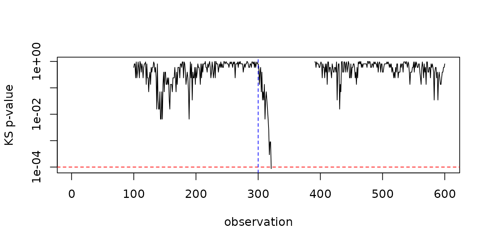

# Configuring detectors

The defaults of every detector were calibrated so that false alarms are
rare on the bundled data. Real streams differ, so this vignette shows
how to read what a detector monitors, how to choose its threshold for
your own data, and how the window policy changes what it compares.

``` r

library(daltoolbox)
library(heimdall)
```

## Reading the drifter output

Besides the drift decision, every detector exposes the statistic it
monitors. After [`fit()`](https://rdrr.io/pkg/daltoolbox/man/fit.html),
`drifter_output` holds one row per observation; rows are `NA` while the
detector has nothing to report, for example while its window fills.

``` r

set.seed(1)
stream <- c(rnorm(300), rnorm(300, mean = 1.5))

model <- fit(dfr_kswin(window_size = 100, stat_size = 30, seed = 1), stream)
head(model$drifter_output[95:105, ])
#>       D         p
#> 95   NA        NA
#> 96   NA        NA
#> 97   NA        NA
#> 98   NA        NA
#> 99   NA        NA
#> 100 0.2 0.5940706
```

KSWIN reports the Kolmogorov-Smirnov statistic `D` and its p-value `p`.
Plotting the p-value on a log scale shows where the two halves of the
window stop looking alike:

``` r

plot(model$drifter_output$p, log = "y", type = "l", xlab = "observation", ylab = "KS p-value")
abline(h = model$state$alpha, col = "red", lty = 2)
abline(v = 300, col = "blue", lty = 2)
```



The column names of each detector are listed in the README.
[`stealthy()`](https://cefet-rj-dal.github.io/heimdall/reference/stealthy.md)
exposes the output of its drifter in the same way, with one row per row
of the data it received.

## Calibrating a threshold

A threshold trades false alarms for detection delay. A practical way to
choose it is to run the detector, with a threshold it can never reach,
on data you consider stable, and look at the largest value its statistic
reaches. A threshold above that value keeps false alarms rare on similar
data.

``` r

set.seed(2)
stable <- data.frame(a = rnorm(1500))
no_alarm <- fit(dfr_kldist(threshold = 1e6), stable)
null_max <- max(no_alarm$drifter_output$divergence, na.rm = TRUE)
null_max
#> [1] 0.06922555
```

Then check that the change you want to catch exceeds it:

``` r

shifted <- data.frame(a = c(rnorm(300), rnorm(300, mean = 2)))
peak <- fit(dfr_kldist(threshold = 1e6), shifted)$drifter_output$divergence
max(peak[301:400], na.rm = TRUE)
#> [1] 0.1815358
```

When the statistic of the change you care about does not rise clearly
above the stable maximum, the detector cannot separate it from noise
with that window: use a larger `window_size` (or a different detector)
rather than a lower threshold. The default `threshold = 0.12` of
[`dfr_kldist()`](https://cefet-rj-dal.github.io/heimdall/reference/dfr_kldist.md)
was chosen exactly this way, for the default 100-row window.

For hypothesis-test detectors
([`dfr_kswin()`](https://cefet-rj-dal.github.io/heimdall/reference/dfr_kswin.md),
[`dfr_lbdd()`](https://cefet-rj-dal.github.io/heimdall/reference/dfr_lbdd.md),
[`dfr_mcdd()`](https://cefet-rj-dal.github.io/heimdall/reference/dfr_mcdd.md)),
the threshold is the significance level `alpha`. Since they test at
every observation, `alpha` must be much smaller than the usual 0.05; the
defaults are between `1e-3` and `1e-4`.

## Sliding and anchored windows

The window-based detectors
([`dfr_kswin()`](https://cefet-rj-dal.github.io/heimdall/reference/dfr_kswin.md),
[`dfr_lbdd()`](https://cefet-rj-dal.github.io/heimdall/reference/dfr_lbdd.md),
[`dfr_mcdd()`](https://cefet-rj-dal.github.io/heimdall/reference/dfr_mcdd.md),
[`dfr_kldist()`](https://cefet-rj-dal.github.io/heimdall/reference/dfr_kldist.md)
and
[`dfr_aedd()`](https://cefet-rj-dal.github.io/heimdall/reference/dfr_aedd.md))
compare an older reference half of their window with a recent half.
`window_type` decides which data the reference holds:

- `"sliding"` (the default) keeps the last `window_size` observations,
  so the reference moves with the stream. It detects changes relative to
  the recent past, and its memory is bounded.
- `"anchored"` keeps every observation, so the reference half stays
  pinned to the beginning of the stream. It detects changes relative to
  the start, and its memory grows with the stream.

``` r

set.seed(3)
gradual <- seq(0, 3, length.out = 1000) + rnorm(1000, sd = 0.5)

sliding <- fit(dfr_mcdd(window_size = 100, alpha = 1e-4), gradual)
anchored <- fit(dfr_mcdd(window_size = 100, alpha = 1e-4, window_type = "anchored"), gradual)

c(sliding = sliding$drifted, anchored = anchored$drifted)
#>  sliding anchored 
#>    FALSE     TRUE
```

On this slow trend, consecutive halves of a sliding window are too
similar to reject, while the anchored reference keeps the early level
and eventually differs from the recent data. The price is memory: until
a drift is reported, the anchored window keeps every observation.

``` r

stable <- rnorm(1000)
c(
  sliding = length(fit(dfr_mcdd(window_size = 100), stable)$state$window),
  anchored = length(fit(dfr_mcdd(window_size = 100, window_type = "anchored"), stable)$state$window)
)
#>  sliding anchored 
#>      100     1000
```

## Speed on long streams

The window-based detectors run their test at every evaluation, which
dominates their cost. `monitoring_step` sets how many observations pass
between two evaluations:

``` r

set.seed(4)
long_stream <- c(rnorm(3000), rnorm(1000, mean = 2))
system.time(every_step <- fit(dfr_lbdd(), long_stream))[["elapsed"]]
#> [1] 1.265
system.time(every_tenth <- fit(dfr_lbdd(monitoring_step = 10), long_stream))[["elapsed"]]
#> [1] 0.206
```

The detection is delayed by at most `monitoring_step` observations. On
long streams, also bound the memory of
[`stealthy()`](https://cefet-rj-dal.github.io/heimdall/reference/stealthy.md)
with `history_size` and of
[`nrm_memory()`](https://cefet-rj-dal.github.io/heimdall/reference/nrm_memory.md)
with `max_size`.
