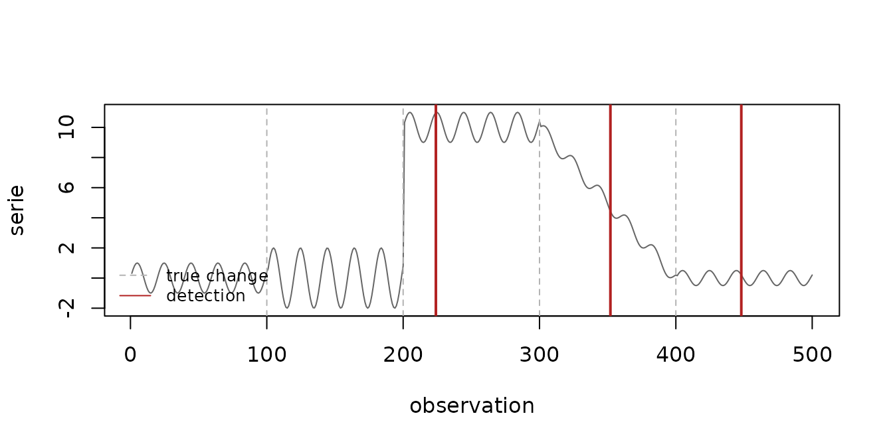
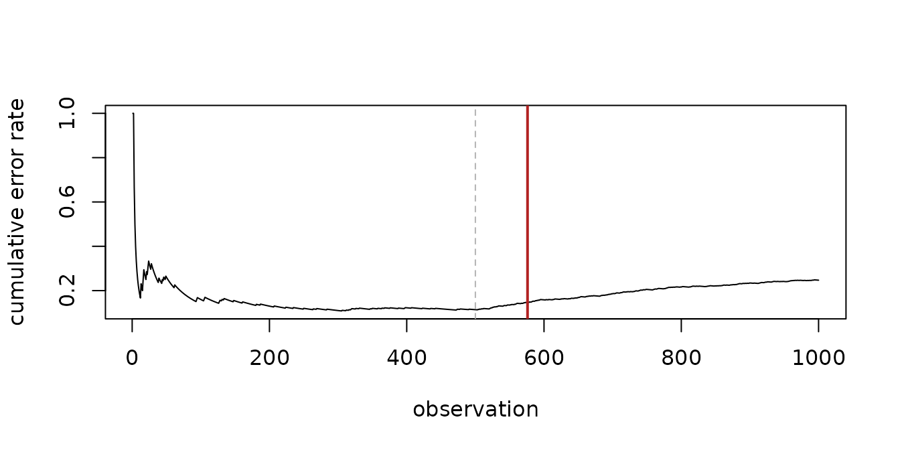

# Getting started with heimdall

Heimdall detects **concept drift** in data streams: moments when the
data, or the relationship between the data and the target, stop behaving
as they did before. This vignette shows the workflow shared by every
detector in the package and when to use each family of detectors.

``` r

library(daltoolbox)
library(heimdall)
```

## Real and virtual concept drift

Heimdall distinguishes two kinds of change:

- **Real concept drift** changes the relationship between the inputs and
  the target. It is visible in the errors of a predictive model, so it
  is monitored with *error-based* detectors:
  [`dfr_ddm()`](https://cefet-rj-dal.github.io/heimdall/reference/dfr_ddm.md),
  [`dfr_eddm()`](https://cefet-rj-dal.github.io/heimdall/reference/dfr_eddm.md),
  [`dfr_hddm()`](https://cefet-rj-dal.github.io/heimdall/reference/dfr_hddm.md),
  [`dfr_ecdd()`](https://cefet-rj-dal.github.io/heimdall/reference/dfr_ecdd.md)
  and
  [`dfr_cusum()`](https://cefet-rj-dal.github.io/heimdall/reference/dfr_cusum.md).
  They receive `1` for a wrong prediction and `0` for a correct one.
- **Virtual concept drift** changes the distribution of the inputs,
  whether or not the model is affected. It is monitored with
  *distribution-based* detectors, which look at a numeric feature
  directly:
  [`dfr_adwin()`](https://cefet-rj-dal.github.io/heimdall/reference/dfr_adwin.md),
  [`dfr_kswin()`](https://cefet-rj-dal.github.io/heimdall/reference/dfr_kswin.md),
  [`dfr_kldist()`](https://cefet-rj-dal.github.io/heimdall/reference/dfr_kldist.md),
  [`dfr_mcdd()`](https://cefet-rj-dal.github.io/heimdall/reference/dfr_mcdd.md),
  [`dfr_lbdd()`](https://cefet-rj-dal.github.io/heimdall/reference/dfr_lbdd.md)
  and
  [`dfr_page_hinkley()`](https://cefet-rj-dal.github.io/heimdall/reference/dfr_page_hinkley.md).
  [`dfr_aedd()`](https://cefet-rj-dal.github.io/heimdall/reference/dfr_aedd.md)
  does the same for several features at once.

## The streaming contract

Every detector follows the same three rules:

1.  `update_state(obj, value)` processes one observation and returns a
    list with the updated detector (`obj`) and a flag (`drift`) telling
    whether a drift was detected **in that call**;
2.  `obj$drifted` is sticky: it stays `TRUE` after the first detection;
3.  `reset_state(obj)` returns the detector to its initial state,
    usually right after a drift has been handled.

The loop below is the canonical way of running a detector over a stream.
It works unchanged for any detector in the package.

``` r

detect <- function(model, stream) {
  output <- list(obj = model, drift = FALSE)
  drifts <- integer(0)
  for (i in seq_along(stream)) {
    output <- update_state(output$obj, stream[i])
    if (output$drift) {
      drifts <- c(drifts, i)
      output$obj <- reset_state(output$obj)
    }
  }
  drifts
}
```

## Virtual drift: monitoring a feature

`st_drift_examples$univariate` is a synthetic series whose behaviour
changes at the observations flagged in the `event` column. ADWIN keeps a
window of adaptive size and shrinks it whenever its older and newer
parts have significantly different means.

``` r

data(st_drift_examples)
serie <- st_drift_examples$univariate

drifts <- detect(dfr_adwin(), serie$serie)
drifts
#> [1] 224 352 448
```

``` r

plot(serie$serie, type = "l", col = "grey40", xlab = "observation", ylab = "serie")
abline(v = which(serie$event), lty = 2, col = "grey70")
abline(v = drifts, col = "firebrick", lwd = 2)
legend("bottomleft", c("true change", "detection"), lty = c(2, 1),
       col = c("grey70", "firebrick"), bty = "n", cex = 0.8)
```



## Real drift: monitoring the errors of a model

Error-based detectors only need the sequence of mistakes of a model.
Here the error rate jumps from 10% to 40% at observation 501.

``` r

set.seed(42)
errors <- c(rbinom(500, 1, 0.1), rbinom(500, 1, 0.4))

detect(dfr_ddm(), errors)
#> [1] 576
detect(dfr_hddm(), errors)
#> [1] 560
```

``` r

plot(cumsum(errors) / seq_along(errors), type = "l", xlab = "observation",
     ylab = "cumulative error rate")
abline(v = 500, lty = 2, col = "grey70")
abline(v = detect(dfr_ddm(), errors), col = "firebrick", lwd = 2)
```



## Processing a whole batch

When there is no need to react to each observation,
[`fit()`](https://rdrr.io/pkg/daltoolbox/man/fit.html) feeds a whole
batch to the detector and returns the updated object. Because `drifted`
is sticky, it tells whether a drift happened anywhere in the batch.

``` r

model <- fit(dfr_ddm(), errors)
model$drifted
#> [1] TRUE
```

## Combining detectors

[`dfr_multi_criteria()`](https://cefet-rj-dal.github.io/heimdall/reference/dfr_multi_criteria.md)
combines several distribution-based detectors. With `combination = "or"`
any detector can raise the alarm, with `"and"` all of them must report a
drift within `fuzzy_window` observations, and `"fuzzy"` weighs each
detection by how recent it is. `model$detections` counts the alarms of
each detector.

``` r

model <- dfr_multi_criteria(
  drifter_list = list(adwin = dfr_adwin(), ph = dfr_page_hinkley()),
  combination = "or"
)
model <- fit(model, data.frame(serie = serie$serie))
model$drifted
#> [1] TRUE
model$detections
#> adwin    ph 
#>     6     1
```

## Baselines

[`dfr_inactive()`](https://cefet-rj-dal.github.io/heimdall/reference/dfr_inactive.md)
never reports a drift and
[`dfr_passive()`](https://cefet-rj-dal.github.io/heimdall/reference/dfr_passive.md)
always does. They are useful as lower and upper references when
evaluating how a model adapts.

## Next steps

- [`vignette("adaptive-models", package = "heimdall")`](https://cefet-rj-dal.github.io/heimdall/articles/adaptive-models.md)
  shows how to retrain a model automatically when a drift is detected.
- The rendered walkthroughs in the [examples
  folder](https://github.com/cefet-rj-dal/heimdall/tree/main/examples)
  cover each detector in more detail.
