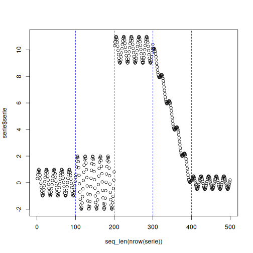

# Inactive Baseline Example

`dfr_inactive()` is a dummy detector that never reports a drift. It does not monitor anything; it exists as a lower baseline, so that the benefit of a real detector can be measured against a model that is never retrained.

## Learning goal

This example shows that the inactive baseline follows the same streaming loop as every other detector, so it can replace any detector in an experiment without changing the surrounding code.


``` r
# Load Heimdall and the synthetic stream example.
library(heimdall)
```


``` r
# Fix the seed for reproducibility.
seed <- 1
set.seed(seed)
```


``` r
# Load the univariate numeric stream used in this example.
data(st_drift_examples)
serie <- st_drift_examples$uv_virtual_drift
```


``` r
# Plot the stream; it has four known change points.
plot(x=seq_len(nrow(serie)), y=serie$serie)
```


``` r
# Instantiate the inactive baseline.
model <- dfr_inactive()
```


``` r
# Run the usual streaming loop.
detection <- NULL
output <- list(obj=model, drift=FALSE)
for (i in seq_len(nrow(serie))){
  output <- update_state(output$obj, serie$serie[i])
  if (output$drift){
    type <- 'drift'
    output$obj <- reset_state(output$obj)
  } else {
    type <- ''
  }
  detection <- rbind(detection, data.frame(idx=i, event=output$drift, type=type))
}
```


``` r
# The baseline never reports a drift, whatever the stream.
detection[detection$type == 'drift',]
```

```
## [1] idx   event type 
## <0 rows> (or 0-length row.names)
```

``` r
sum(detection$event)
```

```
## [1] 0
```


``` r
# The known change points are still there; the baseline simply ignores them.
plot(x=seq_len(nrow(serie)), y=serie$serie)
for (drift_index in which(serie$event)) {
  abline(v=drift_index, col='blue', lty=2)
}
```




``` r
print(paste('Successfull run at', Sys.time()))
```

```
## [1] "Successfull run at 2026-10-16 10:25:23.521762"
```
