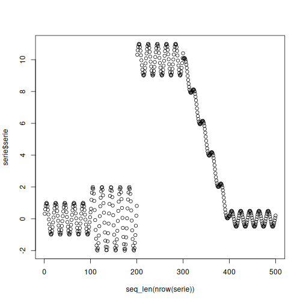
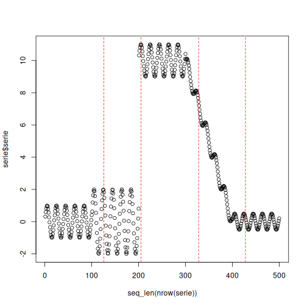

# Multi-Criteria Example

`dfr_multi_criteria()` combines several distribution-based detectors into a single decision. Each detector keeps monitoring the stream on its own, and the combination rule decides when their alarms amount to a drift: `"or"` reports a drift as soon as any detector does, `"and"` when every detector has reported one within `fuzzy_window` observations, and `"fuzzy"` when the decaying weights of the recent alarms exceed half the number of detectors.

In this example, the combined detectors monitor a numeric stream, so the interpretation is **virtual concept drift**.

## Learning goal

This example shows how to combine detectors that see different kinds of change (Page-Hinkley reacts to shifts of the mean and LBDD to changes of spread) and how to read the decision of each one in `drifter_output`.


``` r
# Load Heimdall and the synthetic stream example.
library(heimdall)
```


``` r
# Fix the seed for reproducibility.
seed <- 1
set.seed(seed)
```


``` r
# Load the univariate numeric stream monitored in this example.
data(st_drift_examples)
serie <- st_drift_examples$uv_virtual_drift
```


``` r
# Plot the monitored signal before detection.
plot(x=seq_len(nrow(serie)), y=serie$serie)
```




``` r
# Combine a detector of mean shifts with a detector of spread changes.
model <- dfr_multi_criteria(
  drifter_list=list(
    ph=dfr_page_hinkley(target_feat='serie'),
    lbdd=dfr_lbdd(target_feat='serie', window_size=100, alpha=0.001)
  ),
  combination='or'
)
```


``` r
# Update the combined detector sequentially and record every drift alarm.
detection <- NULL
output <- list(obj=model, drift=FALSE)
for (i in seq_len(nrow(serie))){
  output <- update_state(output$obj, serie[i, 'serie', drop=FALSE])
  if (output$drift){
    type <- 'drift'
    output$obj <- reset_state(output$obj)
  } else {
    type <- ''
  }
  detection <- rbind(detection, data.frame(idx=i, event=output$drift, type=type))
}
```


``` r
# Print the detected drift points.
detection[detection$type == 'drift',]
```

```
##     idx event  type
## 126 126  TRUE drift
## 205 205  TRUE drift
## 328 328  TRUE drift
## 428 428  TRUE drift
```


``` r
# Fit the combined detector on the whole stream to inspect the decision of each detector.
model <- fit(model, serie[, 'serie', drop=FALSE])
head(model$drifter_output)
```

```
##      ph  lbdd
## 1 FALSE FALSE
## 2 FALSE FALSE
## 3 FALSE FALSE
## 4 FALSE FALSE
## 5 FALSE FALSE
## 6 FALSE FALSE
```

``` r
colSums(model$drifter_output)
```

```
##   ph lbdd 
##    1    6
```


``` r
# Overlay the combined alarms on the original numeric stream.
plot(x=seq_len(nrow(serie)), y=serie$serie)
for (drift_index in detection[detection$type == 'drift', 'idx']) {
  abline(v=drift_index, col='red', lty=2)
}
```




``` r
print(paste('Successfull run at', Sys.time()))
```

```
## [1] "Successfull run at 2026-10-16 10:25:28.098857"
```
